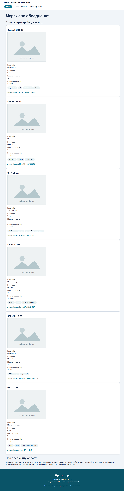
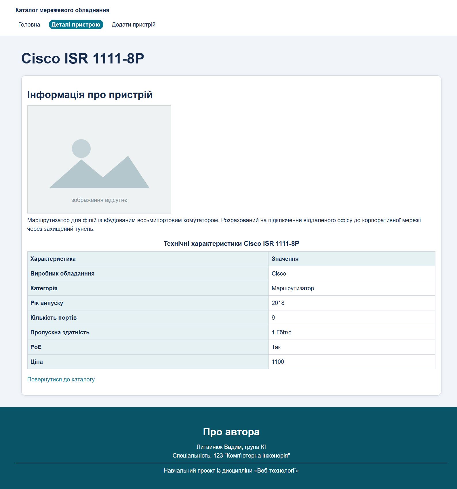
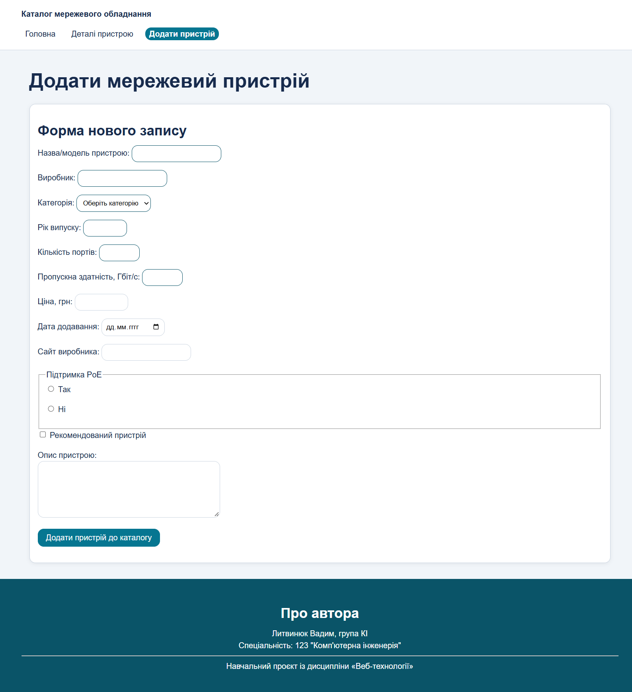
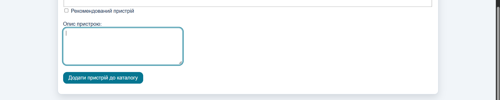
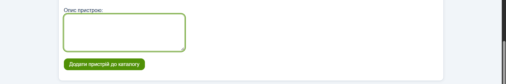

# Звіт з лабораторної роботи № 3

**Тема:** Базове оформлення проєкту та система дизайн-токенів  
**Виконав(ла):** Литвинюк Вадим, група КІ  
**Дата:** [20.11.2026]

---

## 1. Мета роботи

Оформити сторінки, створені в ЛР-2, за допомогою CSS-стилів і змінних, які дозволяють легко змінювати кольори та інші параметри оформлення всього сайту, редагуючи лише кілька значень.

---

## 2. Таблиця токенів

| Ім'я | Значення | Призначення |
|---|---|---|
| `--c-text` | #172b4d | основний колір тексту |
| `--c-text-muted` | #475569 | колір другорядного тексту та підписів |
| `--c-accent` | #067691 | акцентний колір кнопок, посилань і фокуса |
| `--c-accent-dark` | #0a5468 | темний акцент для наведення та підвалу |
| `--c-bg` | #f1f5f9 | фон сторінки |
| `--c-surface` | #ffffff | фон карток і шапки |
| `--c-border` | #cbd5e1 | колір рамок і роздільників |
| `--space-mn` | 0.25rem | мінімальний відступ |
| `--space-sm` | 0.5rem | малий відступ |
| `--space-md` | 1rem | середній відступ |
| `--space-lg` | 2rem | великий відступ |
| `--radius-card` | 0.75rem | заокруглення кутів елементів |
| `--radius-pill` | 999rem | заокруглення тегів |
| `--shadow` | 0 0.125rem 0.5rem rgb(24 34 47 / 0.08) | звичайна тінь карток |
| `--shadow-hover` | 0 0.625rem 1.5rem rgb(24 34 47 / 0.14) | тінь карток при наведенні |

---

## 3. Обґрунтування вибору акцентного кольору

Для оформлення сайту обрано бірюзово-синій колір #067691, який відповідає тематиці мережевого обладнання та добре поєднується зі світлим фоном. Він використовується для кнопок, посилань та інших акцентних елементів.   

За результатами перевірки контрастність акцентного кольору становить 5.23:1 на білому фоні, що перевищує мінімальну вимогу 4,5:1. Для тексту коефіцієнт контрастності становить 12.87:1.

---

## 4. Результати

**Адреса опублікованого сайту:** https://vadymlytvyniuk.github.io/webcatalog/

**Скріншот 1.** Головна сторінка каталогу з підключеним стилем.



**Скріншот 2.** Сторінка з інформацією про пристрій з підключеним стилем.



**Скріншот 3.** Сторінка додавання пристрою з підключеним стилем.



**Скріншот 4.** Елементи сторінки "Додати пристрій" до зміни --c-accent.



**Скріншот 5.** Елементи сторінки "Додати пристрій" після зміни --c-accent.



---

## 5. Пояснення фрагменту коду

```
.button:focus-visible {
    outline: 0.125rem solid var(--c-accent);
    outline-offset: 0.1875rem;
}
```

Селектор .button:focus-visible застосовується до кнопок і посилань із класом .button, коли вони отримують клавіатурний фокус, наприклад під час навігації клавішею Tab. Властивість outline додає акцентну рамку навколо елемента, а outline-offset створює відстань між рамкою та його краєм. Це покращує доступність і допомагає користувачу бачити, який елемент зараз активний, не створюючи зайвого виділення під час кліку мишею.

---

## 6. Труднощі та їх усунення

| Що не вийшло | У чому була причина | Як розв'язано |
|---|---|---|
| | | |
| | | |

Під час виконання роботи жодних проблем не виникало.

---

## 7. Висновок

Під час виконання лабораторної роботи було створено та підключено CSS-файл до всіх трьох сторінок проєкту. За допомогою CSS-змінних сформовано систему дизайн-токенів для керування кольорами, відступами, заокругленнями та тінями. Оформлено основні елементи сторінок і компоненти сайту, налаштовано інтерактивні стани та індикатори фокуса. Перевірено контрастність кольорів, клавіатурну навігацію та доступність за допомогою axe DevTools. Також перевірено керованість стилів шляхом зміни значень CSS-змінних без редагування окремих правил. У результаті отримано узгоджене оформлення, яке можна швидко змінювати та підтримувати.

---

## 8. Використані джерела

[Методичні вказівки до виконання лабораторної роботи](https://classroom.google.com/c/ODc3NjQwNTAyMzI2/a/ODg2MzEyOTI1NTk2/details)   
[Стартовий репозиторій для виконання роботи наданий викладачем](https://github.com/severyn-courses/webcatalog)  
ChatGPT (OpenAI)