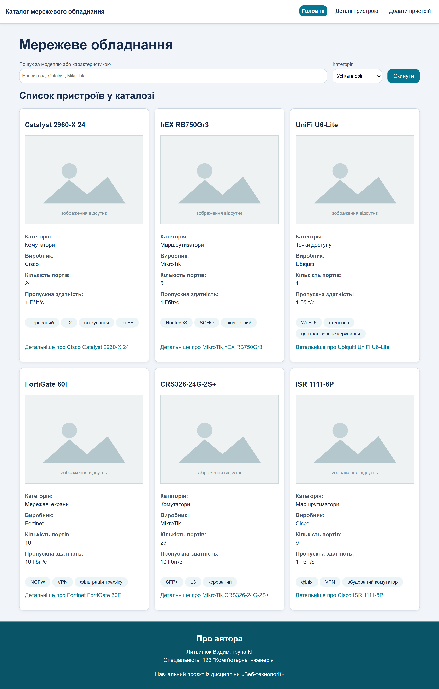
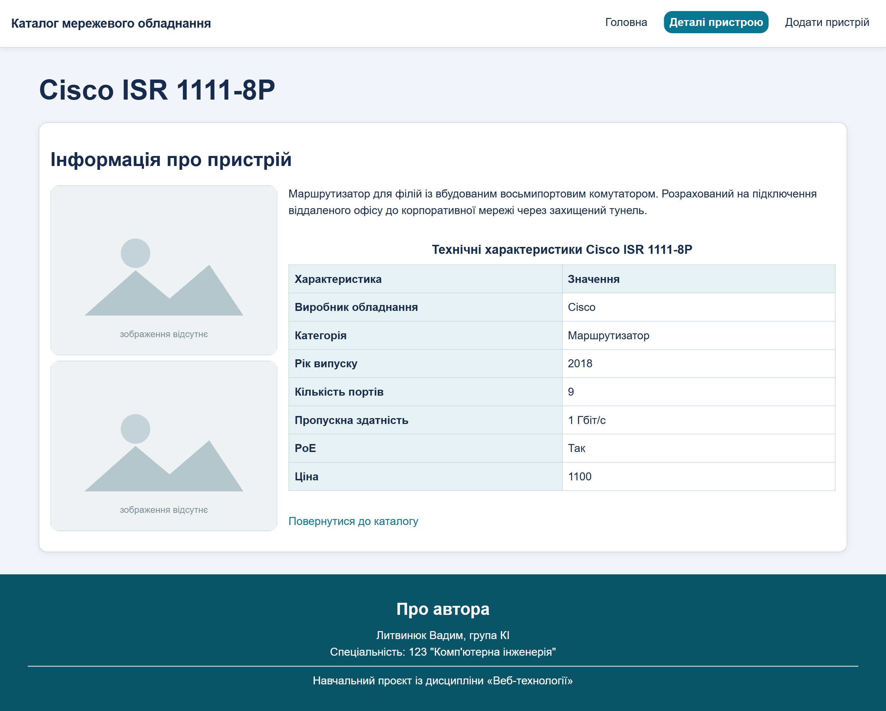
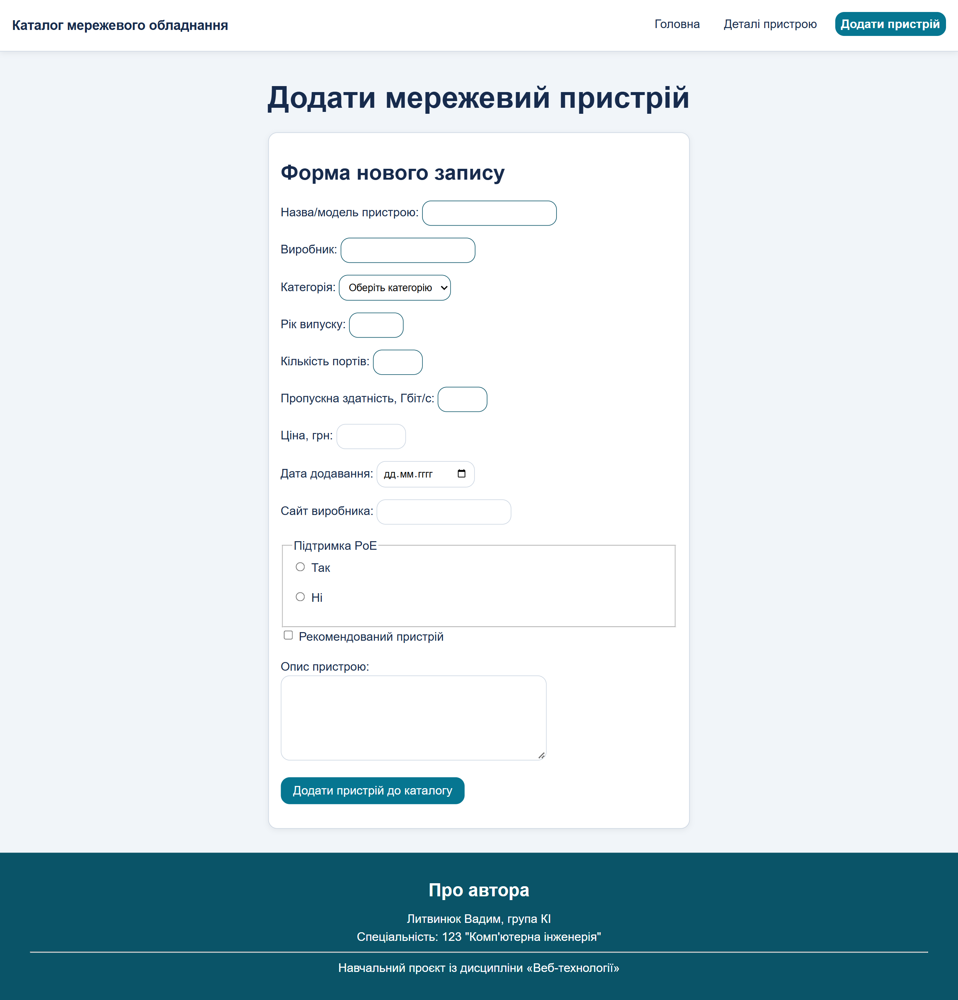
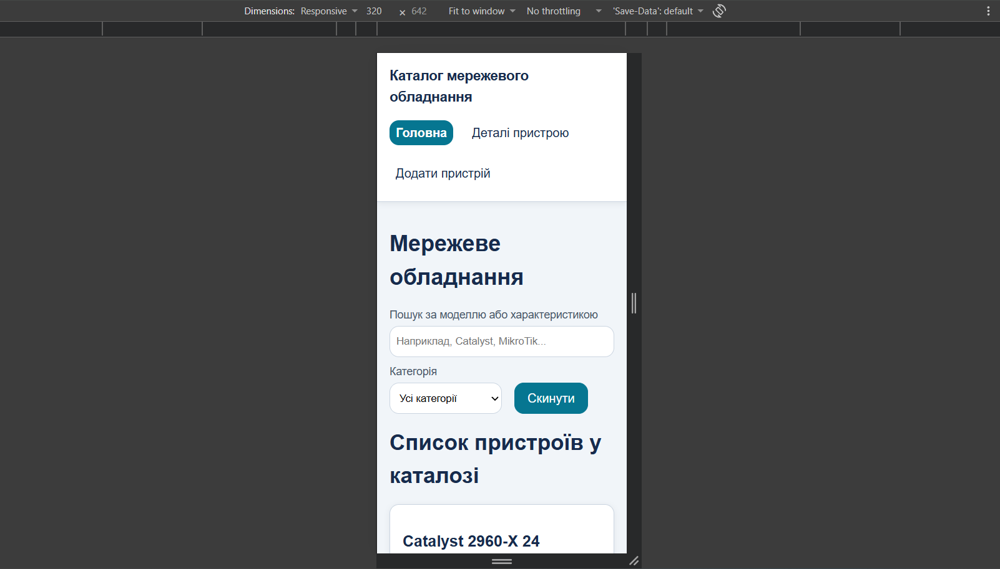
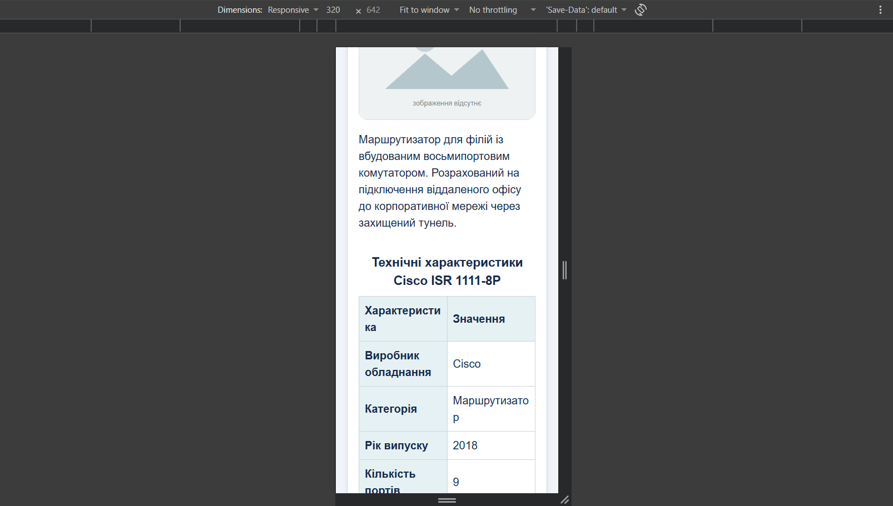
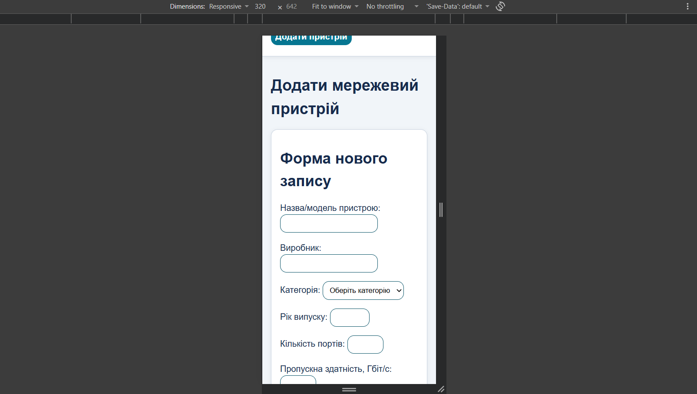
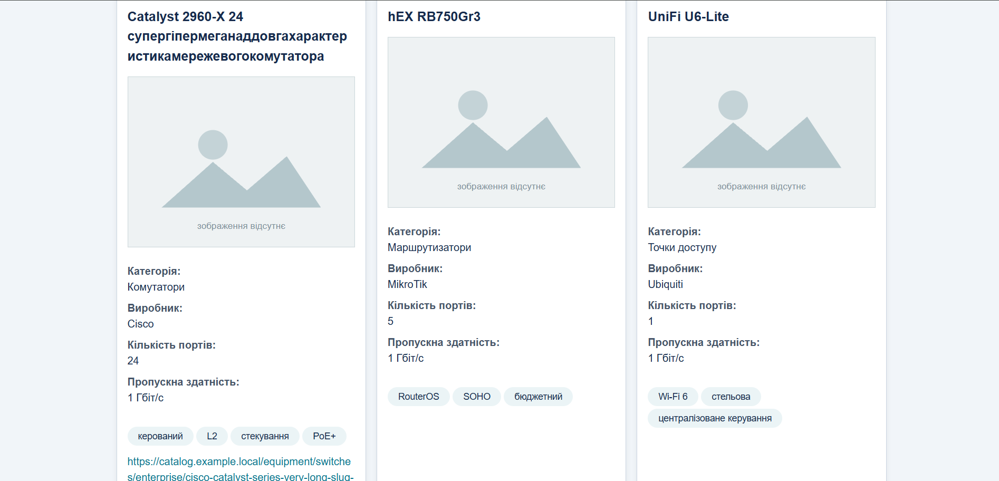
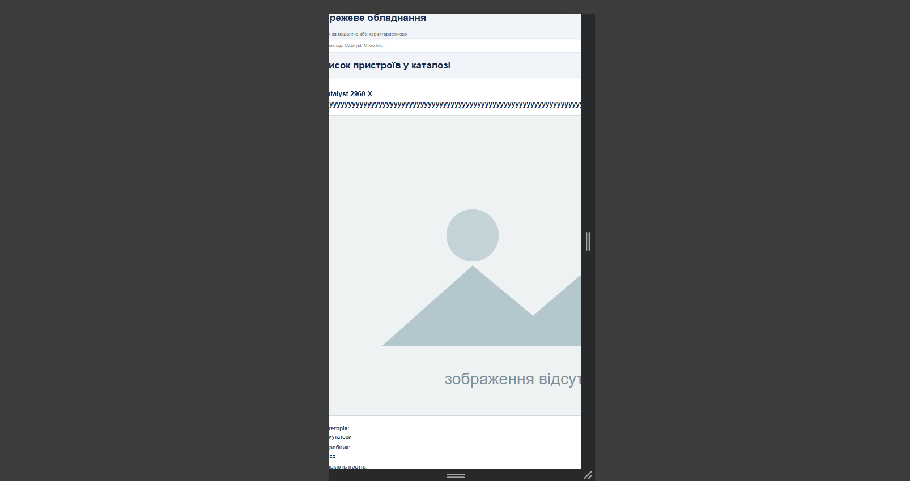

# Звіт з лабораторної роботи № 4

**Тема:** Інтерфейсні блоки проєкту на Flexbox  
**Виконав(ла):** Литвинюк Вадим, група КІ  
**Дата:** [27.11.2026]

---

## 1. Мета роботи

Упорядкувати блоки сайту за допомогою Flexbox: створити шапку з навігацією, картки однакової висоти, панель фільтрів і підвал, який завжди знаходиться внизу сторінки.

---

## 2. Схема розкладки шапки

У шапці сайту використано два флекс-контейнери:

1. .site-header - головний флекс-контейнер, який розміщує назву каталогу ліворуч, а навігацію праворуч. justify-content: space-between розподіляє вільний простір між ними, а align-items: center вирівнює їх по вертикалі. flex-wrap: wrap забезпечує перенесення елементів на вузьких екранах.

2. .site-header nav ul - внутрішній флекс-контейнер, який розташовує пункти навігації в один ряд, вирівнює їх по вертикалі та задає відстані між ними через gap. flex-wrap: wrap дозволяє переносити пункти меню, якщо не вистачає ширини.

---

## 3. Код картки

```
Контейнер списку карток: багаторядковий flex-потік з рівними проміжками
.cards {
    display: flex;
    flex-wrap: wrap;
    gap: var(--space-md);
}

Заголовок усередині .cards займає всю ширину рядка, щоб картки починалися нижче
.cards > h2 {
    flex: 0 0 100%;
    margin: 0;
}

Картка: вертикальний flex-контейнер з гнучкою шириною
.card {
    flex: 1 1 18.5rem;
       flex-grow: 1 - розтягується, щоб заповнити вільне місце в рядку;
       flex-shrink: 1 - стискається, коли бракує місця;
       flex-basis: 18.5rem - базова ширина до перенесення на новий рядок.
    display: flex;
    flex-direction: column;
       Розташовує елементи картки зверху вниз
    gap: var(--space-sm);
       Рівномірні проміжки між елементами всередині картки
}

Притискає останній блок (наприклад, посилання на деталі) до низу картки
.card > p:last-child {
    margin-top: auto;
}

Дозволяє flex-елементу стискатися нижче розміру довгого непереносного вмісту
.card,
.card * {
    min-width: 0;
}
```  

---

## 4. Результати

**Адреса опублікованого сайту:** https://vadymlytvyniuk.github.io/webcatalog/

**Скріншот 1.** Головна сторінка каталогу.



**Скріншот 2.** Сторінка з інформацією про пристрій.



**Скріншот 3.** Сторінка додавання пристрою.



**Скріншот 4.** Скріншот головної сторінки каталогу на ширині 320 px.



**Скріншот 5.** Скріншот сторінки з інформацією про пристрій на ширині 320 px.



**Скріншот 6.** Скріншот сторінки додавання пристрою на ширині 320 px.



**Скріншот 7.** Скріншот картки з навмисно подовженим описом.



---

## 5. Вплив min-width: 0 на адаптивність карток

**Скріншот 8.** Скріншот картки без min-width: 0 (горизонтальне переповнення).



min-width: 0 дозволяє flex-елементу стискатися менше за мінімальну ширину його вмісту. Без цієї властивості довге слово, посилання або таблиця можуть розтягнути блок та спричинити горизонтальне переповнення.

---

## 6. Труднощі та їх усунення

| Що не вийшло | У чому була причина | Як розв'язано |
|---|---|---|
| | | |
| | | |

Під час виконання роботи жодних проблем не виникало.

---

## 7. Висновок

Під час виконання лабораторної роботи було вдосконалено інтерфейс сайту за допомогою Flexbox. Реалізовано адаптивну шапку з навігацією, ряд карток однакової висоти, панель фільтрів, підвал і медіа-блок сторінки деталей. Також налаштовано інтерактивні стани елементів і плавні переходи. Перевірено адаптивність макета, доступність і коректність відображення на різних розмірах екрана. Тестування через axe DevTools для всіх трьох сторінок показало TOTAL ISSUES: 0. Завершені зміни опубліковано через GitHub Pages.

---

## 8. Використані джерела

[Методичні вказівки до виконання лабораторної роботи](https://classroom.google.com/u/0/c/ODc3NjQwNTAyMzI2/a/ODg3MjkwOTcyMTU5/details)   
[Стартовий репозиторій для виконання роботи наданий викладачем](https://github.com/severyn-courses/webcatalog)  
ChatGPT (OpenAI)